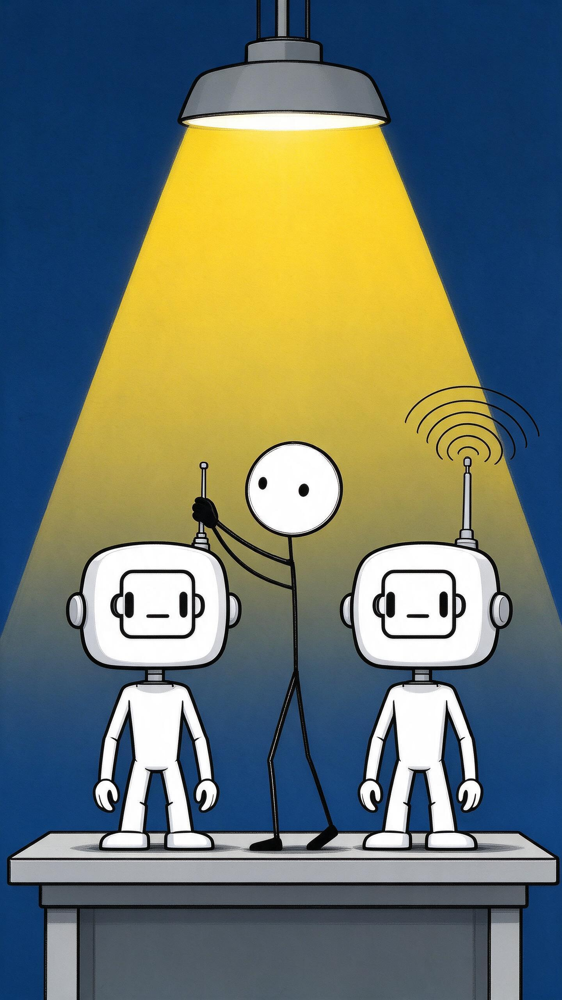

# ai-video-workbench

输入一个主题，自动完成 **分镜 → 生图 → 配音 → 字幕 → 合成 → 发布抖音** 的全流程短视频制作工作台。

人只需要做两件事：提交主题，发布前点一次确认。其余全部自动。

```
主题 ──► LLM 分镜 ──► I2I 生图 ──► TTS 配音 ──► 字幕 ──► ffmpeg 合成 ──► 人工确认 ──► Playwright 发布抖音
              │           │            │          │           │                        │
              └───────────┴───── 步骤级状态落库 · 失败断点续跑 · 单任务并发锁 ────────────┘
```

## 功能亮点

- **一键全流程**：五步任务编排器用 subprocess 串联 LLM 分镜、I2I 图生图、TTS、字幕、ffmpeg 合成等异构 AI 能力，输入主题即可全自动产出成片，仅保留发布前人工确认环节。
- **角色形象一致性**：纯文生图无法复现同一角色，本方案引入**基准图图生图（I2I）**锁定画风与人设——分镜再多，主角始终是同一个「青瓜瓜」。
- **可靠性工程**：步骤级状态落库、失败断点续跑（只补缺失产物）、单任务并发锁、服务重启自动恢复；实战中定位并修复了**锁不可重入死锁、并发检查误含自身、上游失败仍返回退出码 0** 等 3 个并发/可靠性缺陷。
- **抖音自动化发布**：基于 Playwright 的持久化登录态（扫码一次后续免登录）、发布后**读回创作者中心对账**作为成功判据（不信任页面信号）、发布记录逐条落库可追溯。
- **实时体验**：SSE 推送任务进度，2GB 视频流式上传 + Range 分段播放，前端零构建链（原生 JS）。

## 效果展示

以下画面全部由流水线自动产出：LLM 分镜 → 基准图 I2I 生图 → TTS 配音 → ffmpeg 合成。同一角色（「青瓜瓜」：白色大圆头火柴人 + 头顶单根绿色卷须）在任意分镜中形象保持一致，靠的正是基准图图生图而非纯文生图。

| | |
|:---:|:---:|
|  |  |
|  |  |

## 系统架构

```
studio/                          # 工作台（FastAPI）
├─ app.py                        #   页面 + API + SSE + 大文件流式（Range 206）
├─ db.py                         #   SQLite 三表（tasks / steps / publish_records）状态机
├─ pipeline.py                   #   编排器：subprocess 串联四脚本 + 状态落库 + 续跑 + 单任务锁
├─ publisher.py                  #   发布封装：子进程隔离 + 单飞锁 + 结果落库
├─ storyboard.py                 #   分镜 LLM：few-shot 约束 + 严格 JSON 校验 + 字段级兜底
├─ static/ templates/            #   前端（原生 JS，零构建）
└─ publish/                      #   抖音发布模块（仅标准库 + Playwright）
   ├─ douyin_publish.py          #     login / whoami / publish-video CLI
   ├─ login_state.py             #     登录状态机（JSON 状态文件跨进程传递）
   ├─ platform_readback.py       #     发布后读回对账（权威成功判定）
   ├─ content_guard.py           #     出站内容安全闸门
   └─ human_pace.py              #     拟人节奏（风控对抗）

imagegen/                        # 流水线脚本（编排器以子进程驱动）
├─ generate.py                   #   文生图 / 基准图 I2I（火山引擎）
├─ voice.py                      #   edge-tts 配音
├─ subtitle.py                   #   SRT/ASS 字幕
├─ video.py                      #   ffmpeg 三段式合成：逐镜编码 → concat 流拷贝 → 烧字幕
├─ publish.py / monitor.py       #   独立发布与数据监控入口
└─ episodes/                     #   剧集配置（分镜 JSON 示例）

rules/                           # ⭐ 编码 Agent 约束规则（见下文方法论章节）
docs/workflow/                   # ⭐ 五阶段产出物实例（规格驱动开发实证）
青瓜瓜/                           # IP 内容包：人设卡、口播稿、分镜画面
```

## 部署条件

| 依赖 | 要求 | 说明 |
|---|---|---|
| Python | ≥ 3.10（实测 3.12） | Windows / macOS / Linux 均可运行工作台 |
| ffmpeg | PATH 可用 | 视频合成必需（含 ffprobe） |
| Playwright | Chromium 内核 | `pip install playwright && playwright install chromium` |
| 火山引擎 ARK_API_KEY | 生图 | 配置于 `imagegen/.env`，支持 doubao-seedream 系列 |
| 阿里云百炼 DASHSCOPE_API_KEY | 分镜 LLM | OpenAI 兼容端点，qwen-plus |
| TTS | 无需密钥 | edge-tts 免费方案 |

> 注意：抖音发布模块依赖真实浏览器登录态，建议在**有桌面的 Windows 环境**运行完整流程；Web 工作台本身跨平台。

## 快速开始

```bash
# 1. 安装依赖
pip install -r studio/requirements.txt
pip install edge-tts playwright
playwright install chromium

# 2. 配置密钥（参考 .env.example）
cp imagegen/.env.example imagegen/.env    # 填入 ARK_API_KEY / DASHSCOPE_API_KEY

# 3. 启动工作台
cd studio
python -m uvicorn app:app --host 127.0.0.1 --port 8600
```

Windows 下可直接双击仓库根目录的 [`打开工作台.bat`](打开工作台.bat)：自动检测服务状态、后台拉起服务并打开浏览器。

首次使用发布功能时，页面会弹出浏览器二维码，用抖音 App 扫码登录一次，登录态持久化保存，后续无需重复扫码。

## 核心工程设计

**状态机 + 产物校验**：退出码不可信（上游脚本部分失败仍可能返回 0），每个步骤完成后除状态落库外，还要校验产物文件真实存在；「页面状态」与「磁盘事实」双信号一致才推进。

**断点续跑**：每镜产物独立落盘（单镜 mp4、单镜配音、单镜图），重跑时按缺失产物过滤生成清单，从断点精确恢复，不重做已完成工作。

**发布成功的权威判定**：页面 toast 与退出码都可能骗人，发布完成后回到创作者中心**读回作品列表**，与发布前作品快照对账，标题 + 时间窗匹配才算成功。

**并发控制**：单任务并发锁（校验时排除自身，防止任务永久卡死）、发布单飞锁（Chromium profile 目录不允许双进程共享）、SQLite 共享连接统一使用可重入锁（RLock）防止自死锁。

---

## ⭐ 我是如何通过「约束 Coding Agent」完成自动化编程的

本仓库 95% 的代码由 AI coding agent（对话式开发）生成。约束式自动化编程要解决的不是「让 AI 写出代码」，而是**「让 AI 写出的代码就是我要的代码」**——核心手段是把自由对话改造成**规格驱动的受控流程**。

### 传统 vibe coding 的三种失控

| 失控模式 | 表现 | 后果 |
|---|---|---|
| 需求漂移 | 多轮对话后 AI「自作主张」扩大/偏移范围 | 做出一堆没人要的功能 |
| 静默偏离 | 计划说好的方案，实现时悄悄换掉 | 评审失去意义，代码不可预期 |
| 上下文丢失 | 新会话不了解前情，重复返工 | 跨会话项目无法推进 |

### 解法：五阶段规格驱动 + 关口确认（[rules/project_rules.md](rules/project_rules.md)）

给 agent 注入一份**强制性协作规则**，把开发流程切成五个阶段，**每个阶段结束必须停下等人工批准**，批准前禁止写实现代码：

```
① Clarify 需求澄清 ──关口──► ② Spec 规格 ──关口──► ③ Plan 计划 ──关口──► ④ Implement 实现 ──► ⑤ Verify 验证
   01-requirements.md        02-spec.md           03-plan.md           代码+04-changelog.md      05-verification.md
```

四条关键约束：

1. **先文档后代码**：规格未确认前不写实现。AI 擅长快，约束它的「快」正是价值所在——它能在 30 秒内产出一份让我验收的规格，而不是 30 分钟产出一堆方向错误的代码。
2. **产出物落盘**（`docs/workflow/<任务名>/`）：每个阶段的结论固化成文档，成为**跨会话的持久上下文**。新会话先读产出物再干活，直接消解「上下文丢失」。
3. **变更路由**：我中途提的意见必须先分类——小修正就地采纳；改需求就回退到对应阶段文档重新过关口；实现期的新想法进「待办池」不打断当前任务。这条规则专门对付「需求漂移」。
4. **偏离必须显式声明**：实现时发现计划有误，AI 必须停下说明，把偏离点写进 `04-changelog.md`，禁止静默改方案。

实证：本仓库最大的一次开发任务（从零搭出整个工作台）的完整五阶段产出物都保存在 [docs/workflow/douyin-video-pipeline/](docs/workflow/douyin-video-pipeline/)——从 [01-requirements.md](docs/workflow/douyin-video-pipeline/01-requirements.md) 到 [05-verification.md](docs/workflow/douyin-video-pipeline/05-verification.md)（含逐条验收标准与实测证据），可以完整还原当时「人机协作」的全过程。

### 人的角色：关口裁判 + 技术决策者

流程约束解决「怎么做」，以下关键决策仍由人拍板，agent 负责执行与验证：

- **基准图 I2I 约束**：发现纯文生图无法复现角色形象后，决定引入基准图图生图并要求文件缺失时自动降级提示——这是需求级决策；
- **不复用庞大的 Easel 代码库**，新建独立轻量工作台以完全掌控代码结构——这是架构级取舍；
- **验收把关**：`05-verification.md` 里每条验收标准都对照实测证据核销（如 Range 响应实测 `content-range: bytes 0-1023/10468095`），未通过就不关任务。

### 成效

- 全链路从主题到成片到发布真实跑通，服务长期日常使用；
- 三个并发/可靠性缺陷（重入锁死锁、并发检查误含自身、退出码 0 误报）均在验收阶段由证据驱动定位并修复，修复思路沉淀为上文的工程设计；
- 每个功能可追溯到一份规格文档，代码库没有「来历不明」的模块。

> 一句话总结：**把 agent 当成一个很快但没有记忆、爱抢跑的工程师——用规格文档给它外挂记忆，用关口确认踩住它的抢跑，用验收证据链决定收不收货。**

## 安全与隐私

- 所有密钥走 `.env`，不入库（`.gitignore` 已排除）；
- 任务数据库、抖音登录态、生成产物均在本地 `data/`，不入库；
- 发布模块默认 **dry-run**，加 `--exec` 才真正发布；出站内容经 `content_guard` 安全闸门扫描后方可出站。

## License

仅供学习交流。
